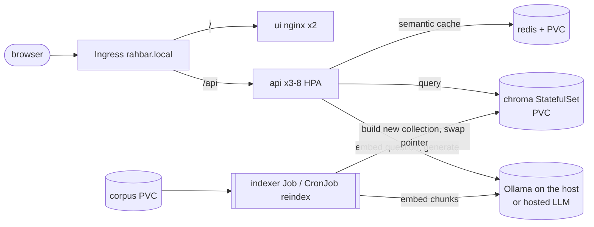

# RAHBAR: grounded question answering on Kubernetes

[](https://github.com/YOUR_ORG/YOUR_REPO/actions/workflows/ci.yml)
[](https://github.com/YOUR_ORG/YOUR_REPO/actions/workflows/cd.yml)

**The problem.** Students ask questions whose answers sit in university policy PDFs, and two versions of
the same policy are both still on the website. RAHBAR answers only from a real document corpus, cites the
exact source and section for every claim, prefers the current version of a policy over a superseded one,
says "the documents do not cover this" instead of guessing, and treats text inside documents and questions
as data, never as instructions. It runs on Kubernetes: a one-shot indexer Job builds the index, three API
replicas only read it, and a CI gate fails any change that makes retrieval, citations or abstention worse.

> **TEAM TODO:** add a screenshot of the chat answering with citations at `docs/evidence/chat.png` and uncomment:
> ``

## Architecture



Details, the reasons for each object, and the request path are in [docs/ARCHITECTURE.md](docs/ARCHITECTURE.md).
Decisions: [docs/adr/](docs/adr/). Pipeline numbers: [docs/PIPELINE.md](docs/PIPELINE.md).

## From a clean clone to an answered question

Prerequisites: Docker, minikube, kubectl, Python 3.12, `make`, and [Ollama](https://ollama.com) on the laptop.

```bash
# 0. Ollama on the host, listening on all interfaces (the cluster reaches it, 127.0.0.1 is not enough)
OLLAMA_HOST=0.0.0.0 ollama serve &
ollama pull llama3.2:3b && ollama pull nomic-embed-text

# 1. Cluster: minikube with Calico (NetworkPolicy is silently ignored without it), metrics-server, ingress
make cluster

# 2. The host address for the NetworkPolicy. If it is not 192.168.49.1, edit the two ipBlock lines in
#    k8s/base/networkpolicies.yaml (api-egress, indexer-egress) and OLLAMA_URL in k8s/base/configmap.yaml.
make host-ip

# 3. Python tools, the corpus (downloads the documents listed in corpus/sources.yaml), and the images
make install
cp corpus/sources.example.yaml corpus/sources.yaml     # then check every entry, see docs/CORPUS.md
make fetch
make images                                            # builds rahbar-{api,indexer,ui}:dev and loads them into minikube

# 4. Deploy. The indexer Job's first init container waits for Chroma AND for documents on the corpus PVC.
make apply                                             # = kubectl apply -f k8s/base/namespace.yaml; kubectl apply -k k8s/overlays/dev
make corpus-load                                       # copies corpus/raw into the corpus PVC; the Job then runs
kubectl get jobs,pods -n rahbar -w                     # wait for job/indexer Complete and api 3/3 Ready

# 5. (hosted provider only) the key comes from the command line, never from a file in git
export LLM_API_KEY=...; make secret

# 6. Ask
echo "$(minikube ip) rahbar.local" | sudo tee -a /etc/hosts      # macOS/Windows: run `minikube tunnel`, use 127.0.0.1
make ask Q="What CGPA puts a student on academic warning?"        # or open http://rahbar.local
make eval                                                         # golden set through the Ingress + the CI gate
```

Re-index with no redeploy and no downtime: `make index` (= `kubectl create job --from=cronjob/reindex ...`).
Run the whole pipeline on your machine with a fake model and no cluster: `make e2e`.

## Endpoints

| Method | Path | Purpose |
| --- | --- | --- |
| POST | `/api/ask` | `{"question": "...", "follow_up": false}` returns the `AskResponse` (answer, citations, retrieved chunks with scores, `cached`) |
| GET | `/healthz` | liveness: the process is alive; never touches Chroma, Redis or the model |
| GET | `/readyz` | readiness: Chroma reachable, collection non-empty, embedding pin holds, Redis reachable; else 503 naming the failed dependency |
| GET | `/metrics` | Prometheus text: request count/latency, retrieval and generation latency, cache lookups by result, abstentions, fallbacks, dropped citations, tokens in/out |

Every response and every log line carries a `request_id` (from `X-Request-ID` or generated). Logs are JSON on stdout.

## Configuration

Everything that changes behaviour is in `k8s/base/configmap.yaml`: chunk size and overlap, `TOP_K`, `RELEVANCE_FLOOR`,
`CACHE_THRESHOLD`, `TEMPERATURE`, `EMBED_MODEL` (read by **both** indexer and API; the API refuses to be ready if they
disagree), `LLM_PROVIDER`, `CHROMA_HOST`. Embeddings are always served from `OLLAMA_URL`, also when generation is hosted.

## Secrets

`*secret*.yaml` is gitignored. [`k8s/base/secret.placeholder.yaml`](k8s/base/secret.placeholder.yaml) documents the shape with
`REPLACE_ME`, and is not in any kustomization. The real Secret is created with `make secret`
(`kubectl create secret generic rahbar-secret ... --from-literal`). Base64 is encoding, not encryption.

## Development

```bash
make install && make test && make lint     # unit tests (stubs only) and ruff + mypy
make dev                                   # API with stubs and the UI on http://localhost:8000
make e2e                                   # indexer -> Chroma -> API -> eval gate, local, fake model
```

### Branches and CI/CD

`dev` is for work. Before submission, configure protection for `main` (no direct pushes, pull request required, `lint`, `test`,
`manifests`, `build`, `scan`, and `e2e-eval` required to pass, one approval). `ci.yml` runs on pull requests to `main` and pushes to `dev`; `cd.yml` runs on
pushes to `main`: `test`, then `build-push` (images tagged with the commit SHA on Docker Hub), then `deploy` (an ephemeral
kind cluster running exactly those SHA images, a rollout check and a smoke test through the Ingress).
Required GitHub secrets: `DOCKERHUB_USERNAME`, `DOCKERHUB_TOKEN` (an access token, not your password).
What is running is always `kubectl get deploy -n rahbar -o wide`, whose image tag is a commit you can `git show`.
In CI the e2e job uses `eval/fake_ollama.py` (a deterministic stand-in for Ollama), so it measures the pipeline and
the gate, not a real model; real-model numbers are in `eval/baseline.json` and docs/FAILURE-ANALYSIS.md.
