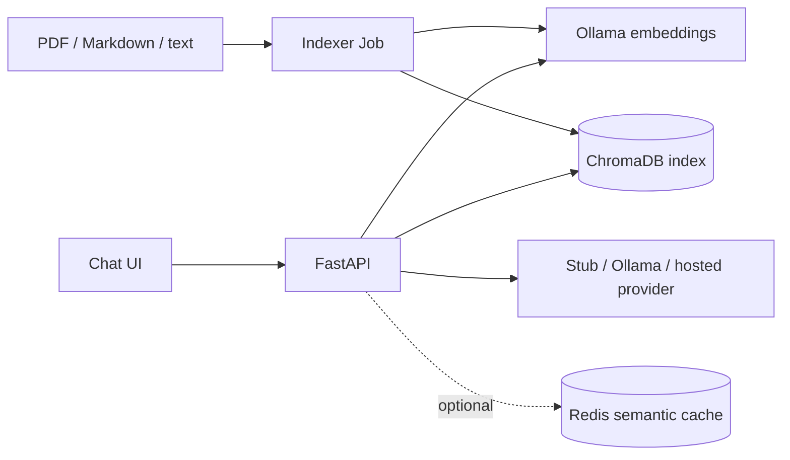

# RAHBAR

RAHBAR is a retrieval-augmented question answering service for university policy documents.
The indexer extracts and cleans PDF, Markdown, text, and HTML content, chunks it with
section and version metadata, obtains embeddings from a pinned Ollama model, and writes a
Chroma collection. The FastAPI process reads that existing index, retrieves relevant
passages, and asks a configurable provider for a schema-validated, cited answer. When
retrieval is weak or generation fails validation, it abstains. The repository also
contains an offline stub path, optional Redis semantic cache, Prometheus metrics, and a
fixture evaluation runner.

## Architecture



The indexer and API are separate programs. The API never builds or mutates the index.
Dockerfiles are present for all three components. Kubernetes manifests and CI workflows
are intentionally not included in this implementation scope, so there is no deploy badge,
cluster apply order, or deployment screenshot to report. The system has not been deployed.

## Local stub run

Python 3.12 and make are expected. From the repository root:

```bash
make install
make test
make lint
make dev
```

Open <http://localhost:8000>. The default development target uses the stub retriever and
provider and serves `ui/index.html`; it requires no model, Chroma, Redis, or API key. The
stub demonstrates the UI/API contract and is not a real university answer system.

## Local fixture RAG run

For a real retrieval path, start pinned ChromaDB and Ollama. Install Ollama separately,
then download the same embedding and generation models configured below:

Start the Ollama service in one terminal with `ollama serve`, then fetch models from
another terminal:

```bash
ollama pull nomic-embed-text
ollama pull llama3.2:3b
```

In another terminal, start the pinned Chroma server (host port 8001 avoids conflicts with
Ollama's default port):

```bash
docker run --rm -p 8001:8000 chromadb/chroma:1.0.12
```

Then, from the repository root, index the included fixtures:

```bash
cd indexer
EMBED_MODEL=nomic-embed-text CORPUS_DIR=../eval/fixtures \
CHROMA_HOST=localhost CHROMA_PORT=8001 OLLAMA_URL=http://localhost:11434 \
python3 -m pipeline.run
```

In another terminal, run the API and fixture evaluation:

```bash
cd api
RETRIEVER=chroma LLM_PROVIDER=ollama-host EMBED_MODEL=nomic-embed-text \
CHROMA_HOST=localhost CHROMA_PORT=8001 OLLAMA_URL=http://localhost:11434 \
uvicorn app.main:app --host 0.0.0.0 --port 8000
```

```bash
cd ..
python3 eval/run_eval.py --api http://localhost:8000 \
  --golden eval/fixtures/golden.fixture.yaml \
  --out /tmp/rahbar-fixture-results.json
```

The indexer Docker image expects its corpus at `/corpus` (normally supplied as a Job
volume). The Docker image intentionally does not bake in ignored corpus downloads.
`RETRIEVER`, `LLM_PROVIDER`, `EMBED_MODEL`, Chroma settings, provider URL/model, optional
Redis URL, relevance floor, and cache threshold are configured through environment
variables. Only set `LLM_API_KEY` in the environment/secret manager for hosted mode.

## Kubernetes status

There is no cluster start or exact `kubectl apply` order in this checkout: the `k8s/`
directory is empty, and this implementation was explicitly scoped to leave Kubernetes
resources and deployment untouched. Although the starter's make targets mention commands
such as `minikube start` and `kubectl apply -k k8s/overlays/dev`, those targets cannot
complete until manifests are supplied. Do not treat them as working deployment steps.

## API

| Method | Path | Purpose |
| --- | --- | --- |
| GET | `/healthz` | Liveness only; no dependency calls |
| GET | `/readyz` | Chroma population and embedding pin, plus configured Redis check |
| GET | `/metrics` | Prometheus request, latency, cache, abstention and fallback metrics |
| POST | `/api/ask` | Ask a question; returns answer, citations, retrieval details and provider |

Example request: `curl -X POST http://localhost:8000/api/ask -H 'Content-Type: application/json' -d '{"question":"What is the attendance requirement?"}'`.

## Evaluation and known gaps

`eval/golden.yaml` has fifteen fixture-grounded questions. It must be replaced or expanded
with questions checked against the selected university corpus. No evaluation results or
baseline are checked in because no indexed API was available while implementing this
change; running the fixture evaluation is necessary before reporting retrieval quality.
See `docs/PIPELINE.md`, `docs/CORPUS.md`, and `docs/AI-USAGE.md` for measured/unmeasured
work and the student review record. The submission checker reports additional cluster,
workflow, corpus, evidence, and partnership requirements that are outside the authorized
scope or require student-provided source documents and measured deployment evidence.
