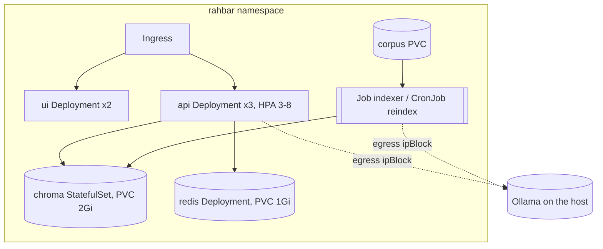

# Architecture

## The request path (`POST /api/ask`)

1. **Receive and validate** (`routes/ask.py`, pydantic): 3-500 characters.
2. **Cache** (`services/cache.py`): embed the question; if a cached question of the *current index* is within
   `CACHE_THRESHOLD` cosine similarity, return its answer with `cached: true`. Skipped for follow-ups and for
   questions that ask about an older version.
3. **Retrieve** (`retrieval/chroma.py`): embed with the pinned model, query the active collection for `TOP_K`,
   filtering `superseded = false` in the query itself unless the question explicitly asks about an old version
   (`retrieval/version.py`). Score = 1 - cosine distance.
4. **Abstain** (`services/answer.py`): if the best passage is below `RELEVANCE_FLOOR`, answer "the documents do not
   cover this" with `answered_from_context: false`, without calling the model.
5. **Augment** (`services/prompt.py`): rules first, then numbered `<passage>` blocks inside `<evidence>`, then the
   `<question>`. Passage text and the question are HTML-escaped so they cannot close the delimiters, and the rules
   say that everything inside the tags is data.
6. **Generate** (`providers/llm/`): schema-constrained JSON.
7. **Validate** (`services/validate.py`): parse with pydantic; drop every citation that does not match a retrieved
   chunk; an answer with no valid citation is rejected. Retry once; then the safe fallback, never a 500.
8. **Store in the cache** only validated, grounded answers.

## Why each object is what it is

| Object | Kind | Reason |
| --- | --- | --- |
| api | Deployment x3, `maxUnavailable: 0`, HPA 3-8 | stateless; readiness gates traffic on the index existing |
| ui | Deployment x2, nginx-unprivileged | static files; 8080, `/tmp` emptyDir for a read-only root |
| chroma | **StatefulSet**, 1 replica, `volumeClaimTemplates` | it owns one volume. A Deployment's rolling update would start the new pod beside the old one on the same PVC; a StatefulSet gives a stable identity (`chroma-0`) and a PVC that outlives the pod. Single-node Chroma is not clustered, so one replica. |
| redis | Deployment (`Recreate`) + PVC | cache survives restarts; `Recreate` because a ReadWriteOnce volume cannot be mounted twice |
| indexer | Job; CronJob `reindex` weekly | ADR 0001 |
| Services | all ClusterIP | Chroma and Redis are never reachable from outside the cluster |
| NetworkPolicy | default deny, then: ingress controller to ui and api; ui to api; api to chroma, redis, Ollama host; indexer to chroma and Ollama host; chroma only from api and indexer; redis only from api; DNS to kube-dns | the ui pod has no path to chroma |
| ServiceAccount | one per workload, token not mounted | nothing here calls the Kubernetes API |
| Security context | non-root, read-only root filesystem, all capabilities dropped, seccomp RuntimeDefault | section 4.7 |

## Data flow of an index build

`corpus PVC` -> extract (pdfplumber; tables as Markdown; OCR for pages with no text layer) -> clean -> chunk ->
embed (Ollama, pinned model) -> a new collection `rahbar-<timestamp>` with the model name and vector dimension in its
metadata -> pointer collection `rahbar-active` moved to it -> older collections pruned. See PIPELINE.md.
